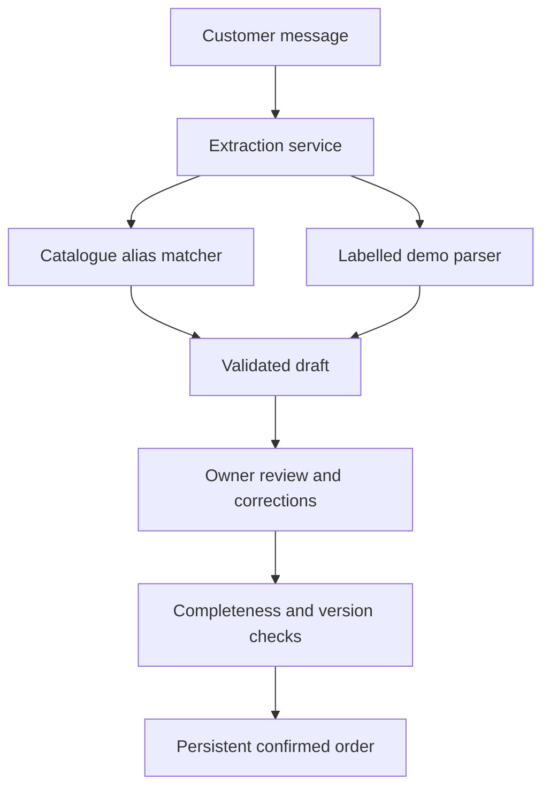

# Mashro3 AI · مشروعي

**A local-first Arabic/English order desk for small and home businesses in Kuwait and the GCC.**

Turn a customer message into an editable order draft, fill in missing details, prepare a clarification reply, and confirm a persistent order. The demonstration business, **The Little Batch**, sells baked goods priced in Kuwaiti dinars.

[](https://github.com/nohasanad321/Mashro3AI/actions/workflows/verify.yml)

[Quick start](#quick-start) · [Demo walkthrough](#demo-walkthrough) · [How it works](#how-it-works) · [API](#api) · [Development roadmap](#development-roadmap)

## What works today

| Capability | Current behavior |
| --- | --- |
| Arabic/English messages | Matches bilingual product aliases and extracts supported details using explicit rules. |
| Catalogue pricing | Natural-message extraction uses prices from the local business catalogue. |
| Owner review | Edit customer, delivery, items, prices, and private notes before approval. |
| Missing details | Lists required fields and blocks confirmation until the draft is complete. |
| Clarification replies | Prepares English or Arabic text for the owner to copy; messages are never sent automatically. |
| Persistent drafts and orders | Save, reload, and browse paginated saved work. Confirmed drafts cannot be edited. |
| Version protection | Rejects stale draft edits; repeat confirmation returns the existing order. |
| Business knowledge | Retrieves local policy excerpts with source IDs; returns no sources when nothing matches. |
| Local web interface | Responsive HTML/CSS/JavaScript served by Spring Boot, with no separate frontend build. |

**Implementation boundary:** the current AI path is lexical retrieval and deterministic extraction. It has no language model, embeddings, vector database, or generated answers. It is a retrieval-only prototype, rather than a complete generative RAG implementation. Runtime features work without an external AI service; the first build still needs internet access to download dependencies.

## Quick start

### Requirements

- **JDK 25**: verify with `java -version`. Point `JAVA_HOME` and your IDE project SDK to JDK 25.
- Git to clone the repository.
- Internet access for the first Maven Wrapper/dependency download.
- Port `8080` available.

Maven is provided through the wrapper. The default `demo` profile uses an embedded H2 file database, so Docker, PostgreSQL, Node.js, model downloads, and API keys are not needed for this path.

### Windows / PowerShell

```powershell
git clone https://github.com/nohasanad321/Mashro3AI.git
cd Mashro3AI
.\mvnw.cmd clean verify
.\mvnw.cmd spring-boot:run "-Dspring-boot.run.profiles=demo"
```

### macOS / Linux

```bash
git clone https://github.com/nohasanad321/Mashro3AI.git
cd Mashro3AI
./mvnw clean verify
./mvnw spring-boot:run -Dspring-boot.run.profiles=demo
```

Open [http://localhost:8080](http://localhost:8080). Health is available at [http://localhost:8080/actuator/health](http://localhost:8080/actuator/health).

### IntelliJ IDEA

1. Open the repository as a Maven project and select **JDK 25** as the project SDK.
2. Let Maven import the dependencies.
3. Run `com.mashro3ai.Mashro3AiApplication` from the repository root. With no active profile configured, `demo` is the default.
4. If an older run configuration explicitly activates `local`, change its active profile to `demo` for the embedded-database setup.

### Build a runnable JAR

After `clean verify` succeeds:

```bash
java -jar target/mashro3ai-0.0.1-SNAPSHOT.jar --spring.profiles.active=demo
```

Run from the repository root to use the same relative database location as the Maven commands.

## Demo walkthrough

Use the supplied synthetic examples to explore the complete order flow:

1. Click **Labelled example**, then **Extract draft**.
2. Review Sara's customer details and the two product lines. The full delivery address is deliberately missing.
3. Enter an example address, such as `Demo block 1, street 2, building 3`.
4. **Save** the review, then **Reload** it to verify persistence.
5. Prepare a missing-details reply in English or Arabic. Copying it does not send it.
6. Confirm the complete draft. Two cookie boxes at `4.500 KWD` plus one brownie box at `3.250 KWD` total **12.250 KWD**.
7. Refresh and reopen the order from **Saved work**.
8. Repeat with **English chat** or **رسالة عربية** to exercise catalogue retrieval. Review every extracted value against the original message.
9. Ask the knowledge panel about `delivery address` to see a policy excerpt and source ID. Ask about `astronomy` to see the no-match behavior.

The labelled parser accepts fields such as `Name:`, `Phone:`, `Method:`, `Area:`, `Address:`, and `Date:`. Dates must use `YYYY-MM-DD`; each item uses `Item: description | quantity | unit price`.

Natural-message extraction supports a limited vocabulary, including catalogue aliases, supported delivery areas, Kuwait phone formats, explicit quantities, and selected relative date words. It does not understand arbitrary Arabic or English.

## How it works



- `DemoExtractionService` chooses the extraction adapter, resolves catalogue products, validates candidate fields, and saves a draft with the original source message and warnings.
- `LocalRetrievalOrderExtractor` matches local aliases and applies extraction rules. Missing quantities stay unknown.
- `CatalogService` supplies catalogue identities and prices for natural-message extraction. Owners can still edit draft prices during review; price-edit authorization is not implemented.
- `OrderDraftService` scopes records to the configured business, checks completeness and versions, prepares clarification text, and confirms orders transactionally.
- `KnowledgeController` searches local keyword-tagged passages and returns their text and source IDs. It does not synthesize an answer.

### Technology

| Layer | Implementation |
| --- | --- |
| Runtime | Java 25, Spring Boot 4.0.8, Maven Wrapper |
| Web/API | Spring MVC, Jakarta Bean Validation, ProblemDetail errors |
| Persistence | Spring Data JPA, Flyway, H2 for the demo; PostgreSQL 17 for local development |
| UI | Static HTML, CSS, and JavaScript |
| Retrieval | Local JSON catalogue and policy passages; bilingual aliases and extraction rules |
| Tests/CI | JUnit, AssertJ, Spring Boot integration tests; GitHub Actions |

### Code map

Paths below are relative to `src/main/java/com/mashro3ai` unless stated otherwise.

| Location | Responsibility |
| --- | --- |
| `business/` | Configured demo business, workspace metadata, retrieval status |
| `catalog/` | Catalogue loading and product matching |
| `ai/application/`, `ai/model/`, `ai/provider/` | Extraction interface, candidate data, local adapters |
| `order/api/` | REST controllers and request/response DTOs |
| `order/application/` | Extraction coordination, draft review, confirmation rules |
| `order/domain/`, `order/persistence/` | Status types, JPA entities, business-scoped repositories |
| `knowledge/` | Source-cited local policy lookup |
| `shared/error/` | Validation and conflict responses |
| `src/main/resources/static/` | Browser interface |
| `src/main/resources/db/migration/` | Versioned schema migrations |
| `src/test/java/` | Retrieval, DTO, persistence, and order-flow tests |

The `customer`, `identity`, and `reporting` packages are placeholders for future work, not completed modules.

## API

All business endpoints use `/api/v1`. Full request semantics and error behavior are documented in [API contracts](docs/api-contracts.md).

| Method | Route | Purpose |
| --- | --- | --- |
| `GET` | `/workspace` | Demo business settings and catalogue |
| `GET` | `/ai/status` | Local retrieval readiness |
| `POST` | `/order-drafts/extract` | Extract and persist a draft |
| `POST` | `/order-drafts` | Create a draft manually |
| `GET` | `/order-drafts?page=0&size=20` | Browse drafts |
| `GET` / `PUT` | `/order-drafts/{id}` | Read / replace editable draft fields |
| `POST` | `/order-drafts/{id}/clarification?language=ar` | Prepare a clarification reply (`en` or `ar`) |
| `POST` | `/order-drafts/{id}/confirm` | Confirm a complete draft |
| `GET` | `/orders?page=0&size=20` | Browse confirmed orders |
| `GET` | `/orders/{id}` | Read an order |
| `GET` | `/knowledge?question=delivery%20address` | Retrieve local policy passages |

Example extraction body for `POST /api/v1/order-drafts/extract`:

```json
{
  "message": "Hi, I am Sara. 2 cookie boxes and 1 brownie box for delivery tomorrow to Salmiya. 55500000",
  "engine": "local"
}
```

Use `"engine": "demo"` for labelled input and `"engine": "local"` for catalogue retrieval. Set the engine explicitly; the UI does this for its selected mode. An optional ISO-8601 `referenceTimestamp` makes relative-date extraction reproducible in the configured business timezone.

## Data and configuration

| Profile | Storage | Usage |
| --- | --- | --- |
| `demo` (default) | H2 file: `./data/mashro3ai.mv.db` | Single-user demonstration; persists across restarts |
| `local` | PostgreSQL: `mashro3ai_demo` by default | Local database development; requires PostgreSQL setup |

Stop the application before copying the H2 database for backup. The path is relative to the process working directory. Two processes must not open the same file simultaneously.

- Catalogue: [`src/main/resources/catalog.json`](src/main/resources/catalog.json). Add product names, Arabic names, aliases, and owner-defined prices here; restart after changes.
- Knowledge: [`src/main/resources/knowledge.json`](src/main/resources/knowledge.json). Add policy passages with stable source IDs and search keywords; restart after changes.
- Business: `mashro3.demo.business-id`, `mashro3.demo.currency`, and `mashro3.demo.timezone` in the profile configuration. These are server settings, not client-supplied identity.
- PostgreSQL overrides: `DB_URL`, `DB_USERNAME`, and `DB_PASSWORD`. The embedded demo profile has its own datasource settings.
- Address: the application binds to `127.0.0.1`.

### Optional PostgreSQL setup

Docker Compose creates `mashro3ai`; the `local` profile deliberately defaults to the separate `mashro3ai_demo` database. On a fresh setup:

```bash
docker compose up -d
# Run once after PostgreSQL is ready:
docker compose exec postgres createdb -U mashro3ai mashro3ai_demo
./mvnw spring-boot:run -Dspring-boot.run.profiles=local
```

On Windows, replace `./mvnw` with `.\mvnw.cmd` and quote the `-Dspring-boot.run.profiles=local` argument. If the demo database already exists, skip `createdb`. Keep any configured database password consistent between Compose and the app.

Flyway applies migrations and Hibernate validates the resulting schema. Preserve existing migrations; introduce schema changes in a new migration.

## Verification and troubleshooting

Run `./mvnw clean verify` (Windows: `.\mvnw.cmd clean verify`). The suite covers bilingual retrieval, knowledge sources and no-match behavior, DTO validation, persistence rules, HTTP validation, review/save/confirm flow, stale updates, confirmation replay, and business-scoped access. Integration tests use in-memory H2; PostgreSQL-specific and concurrent-request behavior need separate verification.

| Symptom | Action |
| --- | --- |
| `release version 25 not supported` | Check the JDK used by Maven and IntelliJ; both must use JDK 25. |
| Maven cannot resolve dependencies | Check internet/proxy access to Maven Central. Runtime retrieval is offline; dependency installation is not. |
| Database connection refused | Check the active profile. Use `demo` for H2 or start PostgreSQL for `local`. |
| Flyway checksum mismatch | Compare the database history with the checked-out migrations. Restore the correct migration files or investigate a controlled repair; do not disable validation or delete retained data to hide the mismatch. |
| Port 8080 already in use | Stop the other application or run the JAR with `--server.port=8081`. |
| Confirmation rejected | Complete the listed missing fields and save the review. For a version conflict, reload the latest draft. |
| Catalogue text is missed | Review aliases and supported phrasing, then correct the draft manually. |

## Current limitations

- Single configured business and no login or business-membership authorization. Use synthetic data and keep the prototype local.
- Rule-based extraction can misread negation, repeated products, and unsupported phrasing. Unknown products may be omitted; source review remains necessary even when all required fields are complete.
- Knowledge lookup uses substring keyword matching, not semantic search or a confidence score.
- The UI is primarily English, with Arabic input and Arabic clarification support.
- No WhatsApp integration, automatic message sending, voice transcription, payments, inventory, delivery-fee calculation, or tax calculation.
- Orders are currently returned as `CONFIRMED`. Other values exist in `OrderStatus`, but persistent status changes and UI controls are not implemented.
- This is an order-desk prototype, not the complete planned mobile back-office product.

## Development roadmap

The following work is planned, not implemented:

1. **Order fulfillment:** persist order status and allow valid transitions through preparing, ready, completed, or cancelled; protect changes against stale updates and add UI actions.
2. **Operational views:** filter work by requested date and status so the owner can see what needs attention.
3. **Extraction improvements:** expand Arabic/English rules, detect ambiguous requests, and add examples that expose failure cases.
4. **Business-managed data:** edit catalogue and policies through validated application flows.
5. **Real-user foundations:** authentication, membership authorization, PostgreSQL verification, and deployment readiness.

For a guided contribution, start with the existing [`OrderStatus`](src/main/java/com/mashro3ai/order/domain/OrderStatus.java) enum, then follow the [code review guide](docs/code-review.md). See [architecture decisions](docs/architecture.md) and the [submission brief](docs/submission.md) for supporting context.
